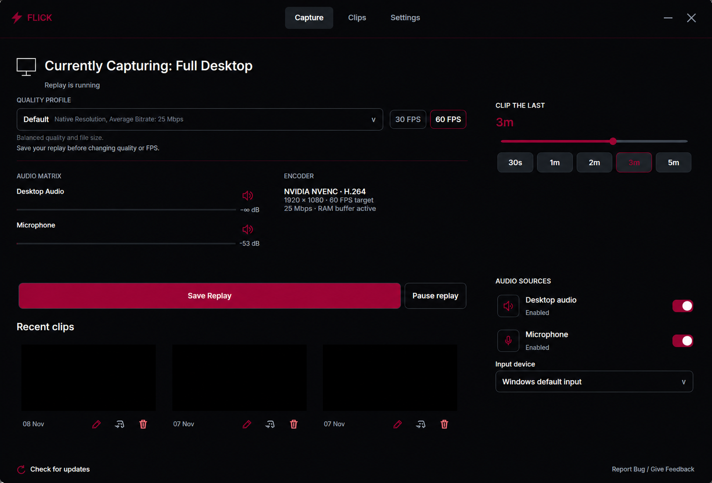
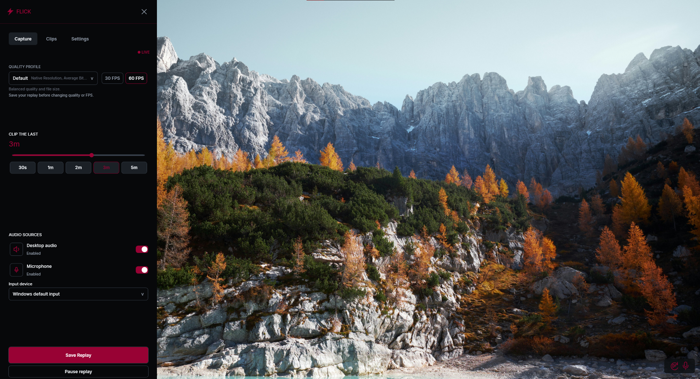
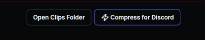
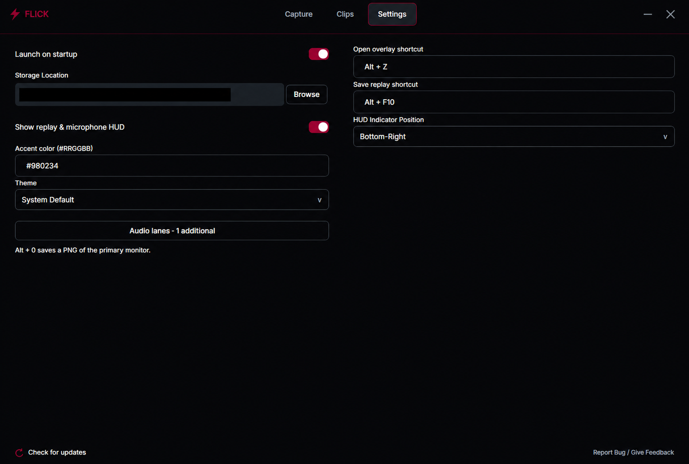

# FLICK V1

**Save the moment. Keep playing.**

### [Download FLICK for Windows (.msi)](https://github.com/ZeeEmn/FLICK/releases/latest/download/FLICK-V1-Setup.msi)

[Portable ZIP](https://github.com/ZeeEmn/FLICK/releases/latest/download/FLICK-V1-Portable.zip) | [All release files](https://github.com/ZeeEmn/FLICK/releases/latest)

FLICK is a free, open-source instant-replay recorder for Windows. It runs in the
background, ready to save recent gameplay with a shortcut. Record locally, capture
screenshots, and watch or edit your clips without leaving the app.

**Zero cloud dependency. No accounts. No subscriptions.**

Your clips belong on your computer. Record, watch, edit, and save without signing
in or relying on an online service. No cloud-storage plan or recurring payment is
needed to use FLICK.

## Features

- **Instant replay:** save up to the last five minutes with a customizable shortcut.
- **Hardware encoding:** automatic NVIDIA NVENC, AMD AMF, or Intel Quick Sync selection when supported.
- **Your quality, your choice:** five profiles with 30 or 60 FPS recording targets.
- **Separate audio tracks:** record desktop audio and microphone independently, with additional device endpoints available in the mixer.
- **Built-in clip library:** cached thumbnails, inline playback, trimming, and middle-section cuts.
- **Screenshots:** capture your primary display at full resolution with Alt + 0.
- **Discord compression:** create a smaller copy of a clip for sharing.
- **Quick sidebar:** access recording controls with Alt + Z.
- **Make it yours:** configurable shortcuts, accent colours, themes, storage location, and an optional corner status HUD.

## <1% CPU Usage

Measured during local testing with hardware encoding enabled.

FLICK uses GPU-accelerated capture and hardware video encoding to keep CPU work
low. It stays in the system tray while you play, with controls available when you
need them. Recording performance depends on your hardware, GPU load, and settings;
software encoding uses more CPU when hardware encoding is unavailable.

## Download and install

Get the latest version from [GitHub Releases](https://github.com/ZeeEmn/FLICK/releases/latest).

| Download | How to use it |
| --- | --- |
| **FLICK-V1-Setup.msi** | Run the setup wizard. The required runtime is included. |
| **FLICK-V1-Portable.zip** | Extract the entire folder and open FLICK.exe. Keep the included files together. |
| **FLICK-V1-SOURCE.zip** | Application source, dependency sources, and build instructions. |

The installer is unsigned, so Windows may display an unknown-publisher warning.
Exit any existing FLICK tray instance before installing an update.

## Start clipping

1. Launch FLICK. Replay starts automatically in the system tray.
2. Open **FLICK Home** from the tray to choose your replay length, quality, and audio sources.
3. Play, then press **Alt + F10** to save the moment.
4. Open **Clips** to watch, edit, or find your saved recordings.

FLICK captures your entire primary display, including visible desktop notifications,
and your selected audio sources. Pause replay when you do not want to record;
exit through the tray menu to close FLICK completely.

| Default shortcut | Action |
| --- | --- |
| **Alt + Z** | Show or hide the sidebar |
| **Alt + F10** | Save a replay |
| **Alt + 0** | Save a full-resolution PNG screenshot |

Sidebar and replay shortcuts can be rebound inside the app. Screenshots use the
number-row 0 key. Clips and screenshots are saved in **Videos/FLICK** by default;
choose another folder under **Storage Location**. Unsaved replay history is cleared
when recording stops.

## Quality profiles

Choose **30 or 60 FPS**, then select a profile:

| Profile | Resolution | Target video bitrate |
| --- | --- | --- |
| Very High | Native display | 60 Mbps |
| High | Native display | 40 Mbps |
| Default | Native display | 25 Mbps |
| Low | 1280 x 720 | 12 Mbps |
| Very Low | 1280 x 720 | 6 Mbps |

Available replay history depends on memory and profile settings.

## Audio and editing

Desktop audio and microphone are saved as separate tracks. Use the mixer to select
additional audio device endpoints or click a speaker icon to mute a lane. Apps
sharing one Windows output device share an audio lane.

Click a clip thumbnail to watch it. Scrubbing pauses audio, and the editor lets you
trim the ends or remove a section from the middle. Save a new copy or overwrite
the original. Copy-based edits follow video keyframes, so cut points and replay
lengths can vary slightly.

**Compress for Discord** creates a smaller copy targeting approximately 49 MB.
**Open Clips Folder** opens your saved files. The trash icon permanently deletes
the selected clip.

## Local first, from recording to editing

- **Zero cloud dependency:** recording, screenshots, playback, and editing work offline.
- **No accounts:** no registration, sign-in, or account linking.
- **No subscriptions:** no recurring fee or cloud-storage plan required.
- **Local files:** clips save directly to your chosen folder, ready to open, copy, or share yourself.

Your recordings, screenshots, and preferences stay on your computer. FLICK does
not upload them. Settings and preview caches live under **%LOCALAPPDATA%/FLICK**;
uninstalling preserves your clips and preferences.

New clips receive a background decode check. Unreadable files are moved to
**%LOCALAPPDATA%/FLICK/quarantine** for inspection rather than permanently deleted.

## Updates

FLICK checks GitHub once when launched. You can also use **Check for updates** at
the bottom-left of Home. Checks run in the background with a four-second timeout
and no periodic polling. GitHub receives ordinary connection metadata and the app
version; FLICK does not download or install updates automatically.

To update, save any replay you need, exit FLICK from the tray, and run the new MSI.

## Requirements

- **Windows 10 version 2004 or later, or Windows 11, 64-bit.**
- Compatible graphics drivers supporting DXGI Desktop Duplication, shared GPU textures, and hardware fences.
- An unrotated primary display with even dimensions, up to **3840 x 2160**.
- Borderless/windowed mode for the desktop sidebar and HUD. Protected content cannot be captured.

Restart replay after changing display resolution.

## Support and source

[Report an issue](https://github.com/ZeeEmn/FLICK/issues/) with your Windows version,
GPU, recording settings, and steps to reproduce it.

Built with **C#, WPF, NAudio, DXGI/D3D11, and FFmpeg**. See
[SOURCE-BUILD.md](source/SOURCE-BUILD.md) for build instructions and
[THIRD-PARTY.md](source/THIRD-PARTY.md) for dependency notices.

Licensed under **GPL-3.0-only**. See [LICENSE](LICENSE).
